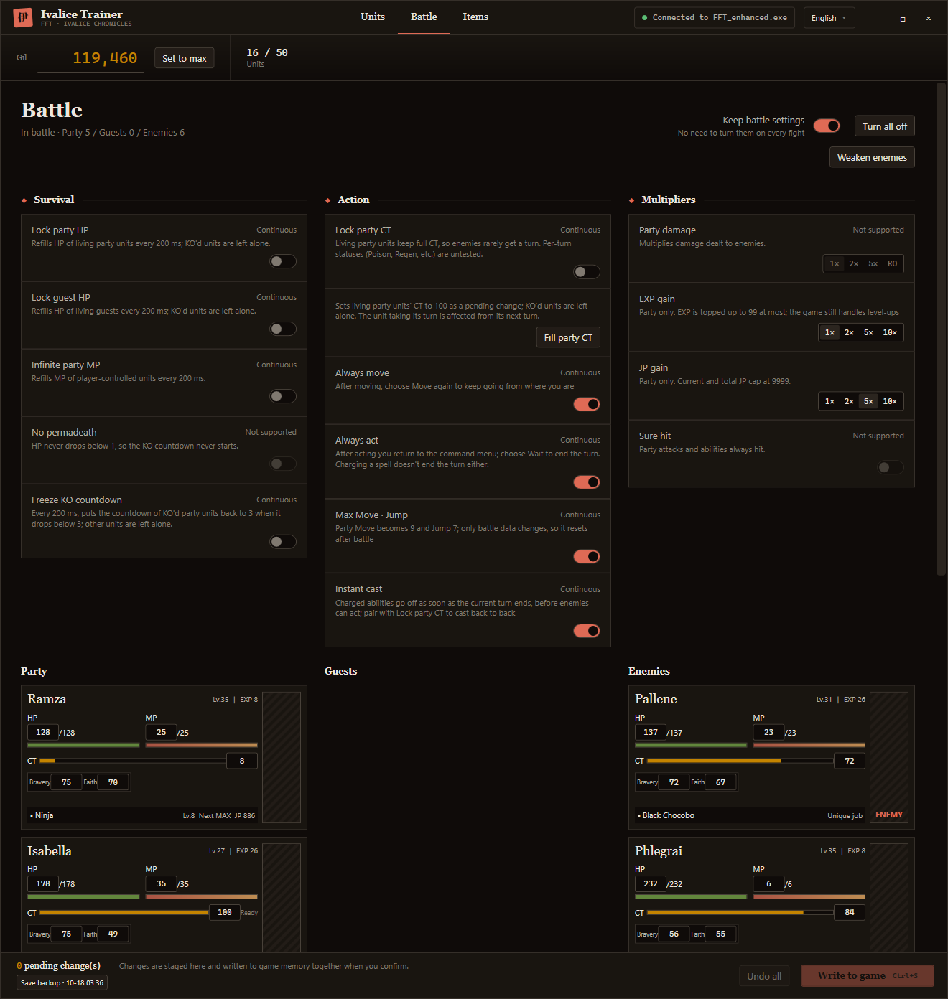
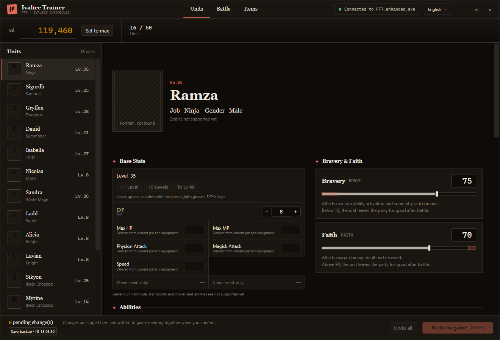
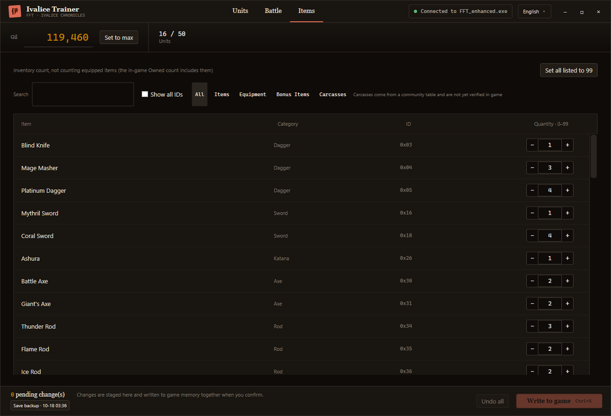

<div align="center">


# Ivalice Trainer

**A free trainer and cheat tool for FFT: The Ivalice Chronicles (FINAL FANTASY TACTICS) on PC. No ads, no account.**

<p align="center">
  <strong>English</strong> |
  <a href="README.zh_CN.md">简体中文</a> |
  <a href="README.zh_TW.md">繁體中文</a>
</p>

<p align="center">
  <a href="LICENSE">
    
  </a>
  <a href="https://github.com/cqagc/ivalice-trainer/releases/latest">
    
  </a>
  
  
</p>

<p align="center">
  <a href="#description">About</a> •
  <a href="#screenshots">Screenshots</a> •
  <a href="#capabilities">Features</a> •
  <a href="#quick-start">Quick start</a> •
  <a href="#development">Development</a> •
  <a href="#documentation">Documentation & community</a> •
  <a href="#upstream">Upstream projects</a> •
  <a href="#license">License</a> •
  <a href="#star-history">Star History</a>
</p>

</div>

<p align="center">
  <a href="docs/screenshots/battle.en.png">
    
  </a>
</p>

---

<a id="description"></a>

## 📝 About

Ivalice Trainer edits your party, items and battles in FINAL FANTASY TACTICS - The Ivalice Chronicles (Steam) while the game is running. It reads and writes game memory directly and does not need Cheat Engine.

It supports the **enhanced mode (`FFT_enhanced.exe`)** on Windows 10 / 11 x64. The interface supports Simplified Chinese, Traditional Chinese, English, French, German, Japanese and Korean, the same languages as the game, and uses the game's own terms in each one.

> [!IMPORTANT]
> This is an unofficial fan-made tool and is not affiliated with SQUARE ENIX. Editing game memory can corrupt saves. The trainer backs up your save folder before writing, but keep your own backups too.

> [!NOTE]
> Memory addresses are verified against Steam build 24304444. After a game update the trainer may stop reading data or refuse to write until it is updated. The current version is **0.1.0**.

---

<a id="screenshots"></a>

## Screenshots

Click an image to view it at full size.

| Units | Items |
|---|---|
| [](docs/screenshots/roster.en.png) | [](docs/screenshots/items.en.png) |

---

<a id="capabilities"></a>

## Features

| Feature | Description |
|---|---|
| Units | Gil, level and EXP, Bravery and Faith, and base stats. Leveling up applies the current job's stat growth. |
| Job JP | Grants JP per job the way the game does: current JP and total JP both increase, and job level follows the game's thresholds. |
| Abilities | Secondary, reaction, support and movement slots. Only abilities the unit has learned are offered. |
| Items | Item counts, including bonus items and carcasses, with search and category filters. |
| Battle: survival | Lock party HP, lock guest HP, infinite party MP, freeze the KO countdown. |
| Battle: actions | Lock party CT, fill party CT, always move, always act, max Move / Jump, instant casting. |
| Multipliers | 2× / 5× / 10× EXP and JP, applied only to what the game actually awards to your party. |
| Keep battle settings | Toggles and multipliers stay on between battles and after restarting the trainer. |
| Staged writes | Unit and item edits are staged and written together with **Write to game** (Ctrl+S). Each write is checked against the game's current values first. |
| Save backups | Before writing, the save folder is copied to `%LOCALAPPDATA%\FftTrainer\save-backups` (at most once every 10 minutes, the latest 20 are kept). |

Unit, job, item and ability names are read at runtime from the game files on your machine, in the language you choose. The trainer ships no game text or assets.

---

<a id="quick-start"></a>

## Quick start

1. Install the [.NET 10 Desktop Runtime](https://dotnet.microsoft.com/download/dotnet/10.0) (x64).
2. Download the zip from [GitHub Releases](https://github.com/cqagc/ivalice-trainer/releases/latest) and extract it.
3. Run `FftTrainer.App.exe`, then start the game. The trainer connects automatically.

Return to the world map or the unit list before writing unit edits; changes written while a shop or the unit screen is open can be overwritten by the game when you leave it. Use the language menu in the title bar to switch languages.

Version 0.1.1 and later include single-instance protection within the same Windows login session: opening another copy requests activation of the existing window instead of starting another trainer. This also applies to copies in different directories. Close older versions before upgrading, because they do not participate in the lock. Window activation remains subject to Windows foreground restrictions.

---

<a id="development"></a>

## Development

You need Windows and the .NET 10 SDK:

```sh
git clone https://github.com/cqagc/ivalice-trainer.git
cd ivalice-trainer
dotnet build src/FftTrainer.App/FftTrainer.App.csproj -c Release
dotnet test tests/FftTrainer.Core.Tests/FftTrainer.Core.Tests.csproj -c Release
dotnet run --project tests/FftTrainer.SingleInstance.Harness/FftTrainer.SingleInstance.Harness.csproj -c Release
```

The single-instance harness uses isolated test lock names and never connects to the game. It checks duplicate launches, cross-directory copies, concurrent startup, normal exit, crash recovery and unresponsive owners.

| Directory | Contents |
|---|---|
| `src/FftTrainer.App/` | WPF interface |
| `src/FftTrainer.Core/` | Memory access, game rules, view models and UI strings (`Locales/`) |
| `src/FftTrainer.GameFiles/` | Reads text tables from the game's pack files |
| `tests/FftTrainer.Core.Tests/` | Unit tests |
| `tools/FftProbe/` | Command-line memory probe: value scan, AOB scan, read / write |
| `docs/` | Memory layout notes |

---

<a id="documentation"></a>

## Documentation & community

| Resource | Description |
|---|---|
| [Memory layout](docs/memory-map.md) | Confirmed addresses and structures for build 24304444 (Chinese) |
| `scripts/check_locales.py` | Checks that every language has the same keys and placeholders |
| [GitHub Issues](https://github.com/cqagc/ivalice-trainer/issues) | Bug reports and feature requests |

When reporting an issue, include the trainer version, the game language, and what you were doing in the game.

---

<a id="upstream"></a>

## 🔗 Upstream projects

Thank you to the maintainers and contributors of these projects. See [THIRD-PARTY-NOTICES.md](THIRD-PARTY-NOTICES.md) for details.

| Project | Use in Ivalice Trainer | License |
|---|---|---|
| [FF16Tools](https://github.com/Nenkai/FF16Tools) | Reading pack files and Nex tables (source subset) | MIT |
| [fftivc-nex-layouts](https://github.com/Nenkai/fftivc-nex-layouts) | Table layouts for the game's text tables | MIT |
| [Vortice.Windows](https://github.com/amerkoleci/Vortice.Windows) | Managed DirectStorage bindings for decompression | MIT |
| [Syroot.BinaryData](https://gitlab.com/Syroot/BinaryData) | Binary reading | MIT |
| [CommunityToolkit.HighPerformance](https://github.com/CommunityToolkit/dotnet) | Memory helpers | MIT |

DirectStorage itself is loaded from the game's own install folder and is not redistributed.

---

<a id="license"></a>

## 📜 License

Ivalice Trainer is licensed under [MIT](LICENSE). Third-party components retain their own licenses. FINAL FANTASY TACTICS is a trademark of SQUARE ENIX.

---

<a id="star-history"></a>

## 🌟 Star History

<div align="center">

[](https://star-history.com/#cqagc/ivalice-trainer&Date)

</div>

---

<div align="center">

### Thanks

If you find Ivalice Trainer useful, consider starring the project.

**[Download latest](https://github.com/cqagc/ivalice-trainer/releases/latest)** • **[Report an issue](https://github.com/cqagc/ivalice-trainer/issues)**

Maintained by [CQAGC](https://www.cqagc.com)

</div>
