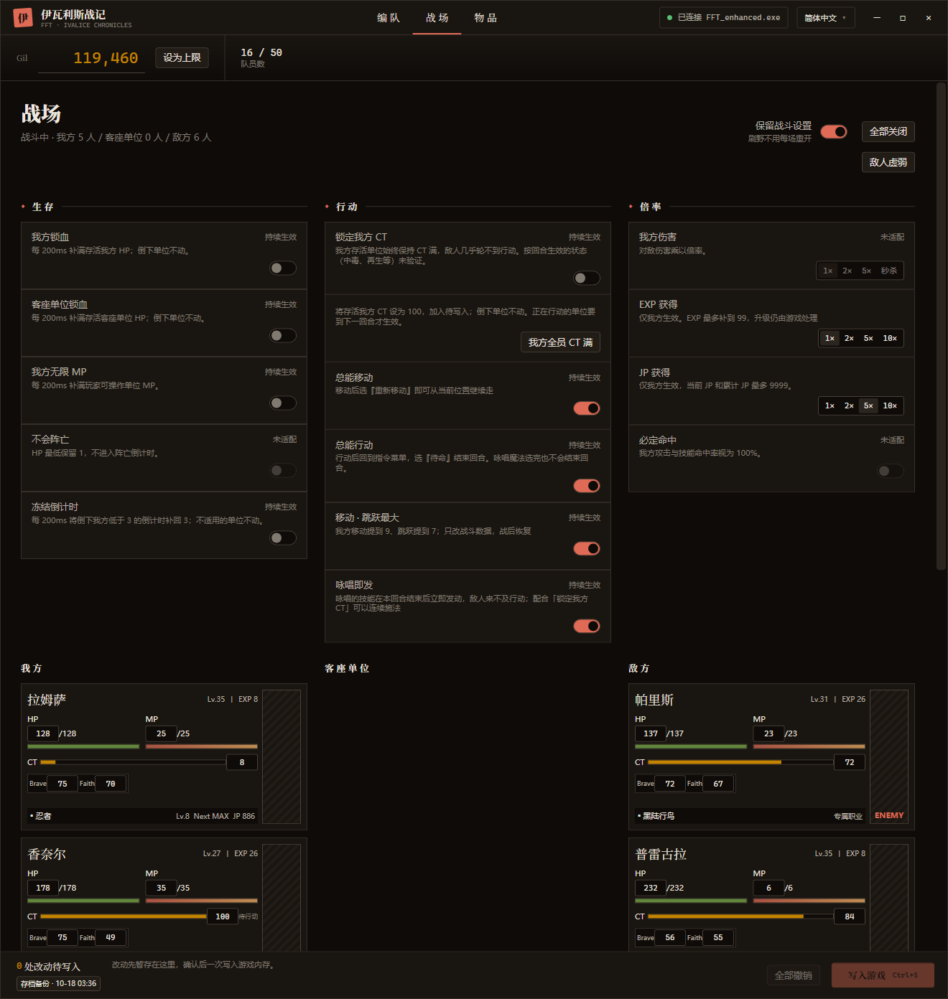
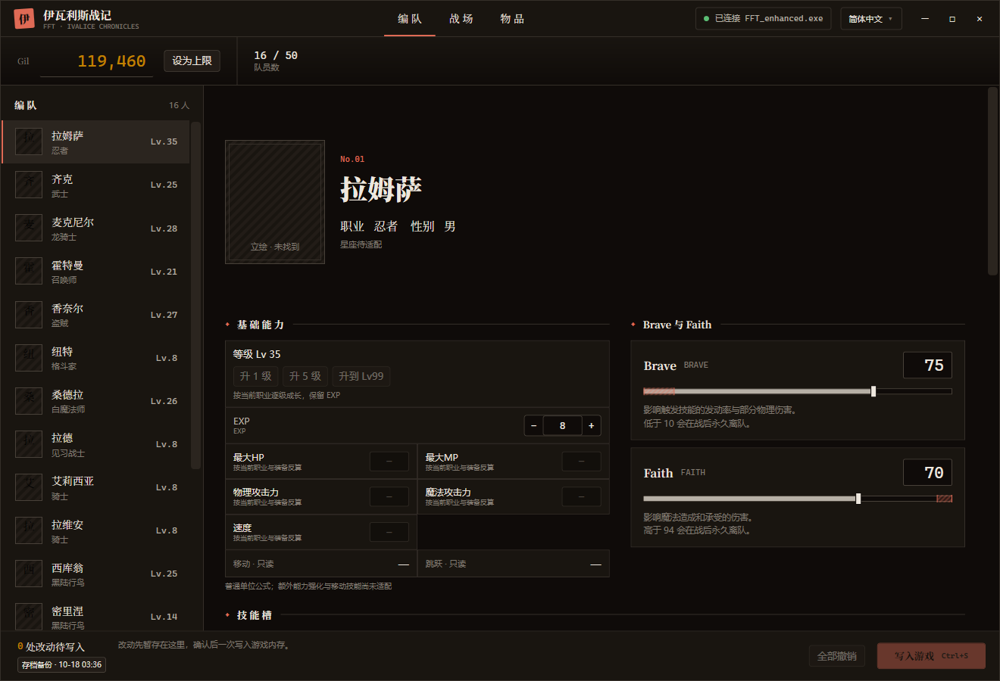
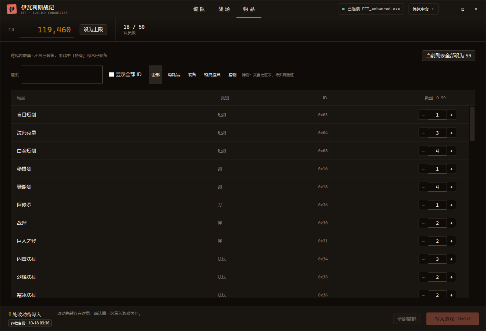

<div align="center">


# Ivalice Trainer

**《最终幻想战略版 伊瓦利斯编年史》（FFT: The Ivalice Chronicles）PC 修改器，免费开源，无广告，不需要账号。**

<p align="center">
  <a href="README.md">English</a> |
  <strong>简体中文</strong> |
  <a href="README.zh_TW.md">繁體中文</a>
</p>

<p align="center">
  <a href="LICENSE">
    
  </a>
  <a href="https://github.com/cqagc/ivalice-trainer/releases/latest">
    
  </a>
  
  
</p>

<p align="center">
  <a href="#description">简介</a> •
  <a href="#screenshots">截图</a> •
  <a href="#capabilities">功能</a> •
  <a href="#quick-start">快速上手</a> •
  <a href="#development">开发</a> •
  <a href="#documentation">文档与社区</a> •
  <a href="#upstream">上游项目</a> •
  <a href="#license">许可证</a> •
  <a href="#star-history">Star History</a>
</p>

</div>

<p align="center">
  <a href="docs/screenshots/battle.zh_CN.png">
    
  </a>
</p>

---

<a id="description"></a>

## 📝 简介

Ivalice Trainer 在游戏运行时修改 FINAL FANTASY TACTICS - The Ivalice Chronicles（Steam 版）的编队、道具和战斗。它直接读写游戏内存，不需要 Cheat Engine。

支持 Windows 10 / 11 x64 上的 **enhanced 版（`FFT_enhanced.exe`）**。界面支持简体中文、繁體中文、English、Français、Deutsch、日本語、한국어，与游戏支持的语言一致，各语言都使用游戏自己的用语。

> [!IMPORTANT]
> 本项目是爱好者制作的非官方工具，与 SQUARE ENIX 无关。修改内存有损坏存档的风险。修改器写入前会备份存档目录，但请自己也做好备份。

> [!NOTE]
> 内存地址按 Steam build 24304444 核对。游戏更新后，在修改器跟进之前可能读不到数据或拒绝写入。当前版本 **0.2.0**。

---

<a id="screenshots"></a>

## 截图

点击图片查看原尺寸。

| 编队 | 物品 |
|---|---|
| [](docs/screenshots/roster.zh_CN.png) | [](docs/screenshots/items.zh_CN.png) |

---

<a id="capabilities"></a>

## 功能

| 功能 | 说明 |
|---|---|
| 编队 | Gil、等级与 EXP、Brave 与 Faith、各项能力值。升级时按当前职业的成长值增长。 |
| 职业 JP | 按游戏的规则增加 JP：当前 JP 和累计 JP 同时增加，职业等级按游戏的门槛更新。 |
| 技能槽 | 正常模式只列出已学会且符合条件的技能，补充九名已核验角色的专属指令。跨角色副指令 Hack 默认关闭，切换指令不等于学习招式。 |
| 学习副指令招式 | 独立实验功能：预览当前已装备副指令的真实招式名称／ID、已学与新增位及写入区域，暂存后再二次确认写入。请先阅读下方安全说明。 |
| 物品 | 支持搜索和分类筛选；虚拟化回收列表、批量刷新并抑制无变化通知，减少库存卡顿。名称旁显示待写数量 `旧值 → 新值`，整行高亮。 |
| 装备详情 | 从本机游戏读取官方说明及已核验 EXE 静态属性；未知项明确显示未知，武器威力不等于最终伤害。 |
| 战斗：生存 | 我方锁血、客座单位锁血、我方无限 MP、冻结阵亡倒计时。 |
| 战斗：行动 | 锁定我方 CT、我方全员 CT 满、总能移动、总能行动、移动 · 跳跃最大、咏唱即发。 |
| 倍率 | EXP 与 JP 获得 2× / 5× / 10×，只放大游戏实际给我方的量。 |
| 保留战斗设置 | 开关和倍率在战斗之间、重启修改器后都保留。 |
| 暂存写入 | 编队和物品的改动先暂存，点 **写入游戏**（Ctrl+S）一次写入；写入前逐项核对游戏里的当前值。 |
| 存档备份 | 写入前把存档目录复制到 `%LOCALAPPDATA%\FftTrainer\save-backups`（10 分钟内最多一次，保留最近 20 份）。 |

单位、职业、物品、技能的名称在运行时从你本机的游戏文件里按所选语言读取，修改器本身不包含任何游戏文本或素材。

---

<a id="quick-start"></a>

## 快速上手

1. 安装 [.NET 10 桌面运行时](https://dotnet.microsoft.com/download/dotnet/10.0)（x64）。
2. 从 [GitHub Releases](https://github.com/cqagc/ivalice-trainer/releases/latest) 下载压缩包并解压。
3. 运行 `FftTrainer.App.exe`，再启动游戏，修改器会自动连接。

写入编队改动前，请先回到世界地图；在商店或队员界面里写入的改动，离开时可能被游戏覆盖。标题栏的语言菜单可以切换界面语言。升级时保留自己的 `assets` 文件夹；本机头像索引修正不代表发布包新增或分发游戏版权图片。

### 0.2.0 实验技能操作与风险

- 正常技能规则补充 Orlandeau、Reis、Mustadio、Marach、Agrias、Beowulf、Rapha、Meliadoul、Cloud 九名角色已核验的专属指令，未知身份仍只读。独立的**跨角色副指令 Hack 默认关闭**，只开放已核验人类指令；它只换副指令，不学习招式，也不绕过武器和招式使用条件。
- 先写入副指令改动并刷新，再打开**当前已装备副指令**的学习预览，核对真实招式名称／ID、已学与新增数量及内存区域，确认暂存后再确认“写入游戏”。取消／重开相应选择器、切换角色、断连或撤销会撤销授权，必要时重新选择或预览。
- 解析 16 个行动槽的真实 ID（包括第 9 位构成的 ID 256），仅按位置 OR 非空有效招式的学习位，保留已有位；不覆盖被动技能、JP 或职业。普通指令使用各自的学习索引；特殊指令共享 **k0**，其他特殊指令可能把相同位置也解释为已学，不能隔离跨指令影响。
- 写前核对身份、连接代次、当前副指令、技能表、原值及三份名册，写后读回精确目标。写入**不是原子事务**，失败可能部分生效；学习功能没有自动重试，请重新读取检查，不要连续盲点写入。
- 已报告的游戏实测：全剑技由 4 项变为全部 11 项可用，换成龙后 8 项全亮。需要**退出整个编队／队员菜单回到世界地图，再重新进入**才更新，不只是关闭技能弹窗。这不代表已验证全部战斗、工作副本或存档重读路径；游戏仍可能覆盖改动。
- 实验前独立备份存档。“撤销”只取消未写入的暂存改动，不能回滚已完成的游戏写入。本版未修复既有 JP 部分写入后的重试问题。

装备数值只读取已核验 build 24304444 的 EXE。其他版本或未核验字段显示未知，不推测盾／饰品回避、元素或状态效果；官方说明的读取与数值是否可用相互独立。

---

<a id="development"></a>

## 开发

需要 Windows 和 .NET 10 SDK：

```sh
git clone https://github.com/cqagc/ivalice-trainer.git
cd ivalice-trainer
dotnet build src/FftTrainer.App/FftTrainer.App.csproj -c Release
dotnet test tests/FftTrainer.Core.Tests/FftTrainer.Core.Tests.csproj -c Release
```

Windows 专用 `tests/FftTrainer.Inventory.Harness/` 使用真实 XAML 与合成名册／会话检查库存回收和编辑，以及 `--hack-ui`、`--learn-ui`，不连接或写入游戏。库存场景需交互桌面，会移动指针并聚焦测试窗口；技能界面场景需传 `--game-root <游戏安装目录>` 只读本机文本，在屏幕外运行且不激活。可用 `--output <结果目录>` 保存本地截图与结果，未经隐私和素材审查不要公开这些输出或文本缓存。

| 目录 | 内容 |
|---|---|
| `src/FftTrainer.App/` | WPF 界面 |
| `src/FftTrainer.Core/` | 内存读写、游戏规则、视图模型和界面文字（`Locales/`） |
| `src/FftTrainer.GameFiles/` | 从游戏封包读取文本表 |
| `tests/FftTrainer.Core.Tests/` | 单元测试 |
| `tools/FftProbe/` | 命令行内存探针：数值扫描、AOB 扫描、读写 |
| `docs/` | 内存布局笔记 |

---

<a id="documentation"></a>

## 文档与社区

| 资源 | 说明 |
|---|---|
| [内存布局](docs/memory-map.md) | build 24304444 已确认的地址和结构 |
| `scripts/check_locales.py` | 检查各语言的 key 和占位符是否一致 |
| [GitHub Issues](https://github.com/cqagc/ivalice-trainer/issues) | 问题反馈和功能建议 |

反馈问题时请写明修改器版本、游戏语言，以及当时在游戏里做什么。

---

<a id="upstream"></a>

## 🔗 上游项目

感谢以下项目的维护者和贡献者。详见 [THIRD-PARTY-NOTICES.md](THIRD-PARTY-NOTICES.md)。

| 项目 | 在本项目中的用途 | 许可证 |
|---|---|---|
| [FF16Tools](https://github.com/Nenkai/FF16Tools) | 读取封包和 Nex 表（源码子集） | MIT |
| [fftivc-nex-layouts](https://github.com/Nenkai/fftivc-nex-layouts) | 游戏文本表的表结构 | MIT |
| [Vortice.Windows](https://github.com/amerkoleci/Vortice.Windows) | DirectStorage 托管绑定，用于解压 | MIT |
| [Syroot.BinaryData](https://gitlab.com/Syroot/BinaryData) | 二进制读取 | MIT |
| [CommunityToolkit.HighPerformance](https://github.com/CommunityToolkit/dotnet) | 内存工具 | MIT |

DirectStorage 本身从游戏安装目录加载，不随修改器分发。

---

<a id="license"></a>

## 📜 许可证

Ivalice Trainer 以 [MIT](LICENSE) 许可证发布。第三方组件保留各自的许可证。FINAL FANTASY TACTICS 是 SQUARE ENIX 的商标。

---

<a id="star-history"></a>

## 🌟 Star History

<div align="center">

[](https://star-history.com/#cqagc/ivalice-trainer&Date)

</div>

---

<div align="center">

### 感谢

如果觉得好用，欢迎给项目点个 Star。

**[下载最新版](https://github.com/cqagc/ivalice-trainer/releases/latest)** • **[反馈问题](https://github.com/cqagc/ivalice-trainer/issues)**

由 [CQAGC](https://www.cqagc.com) 维护

</div>
