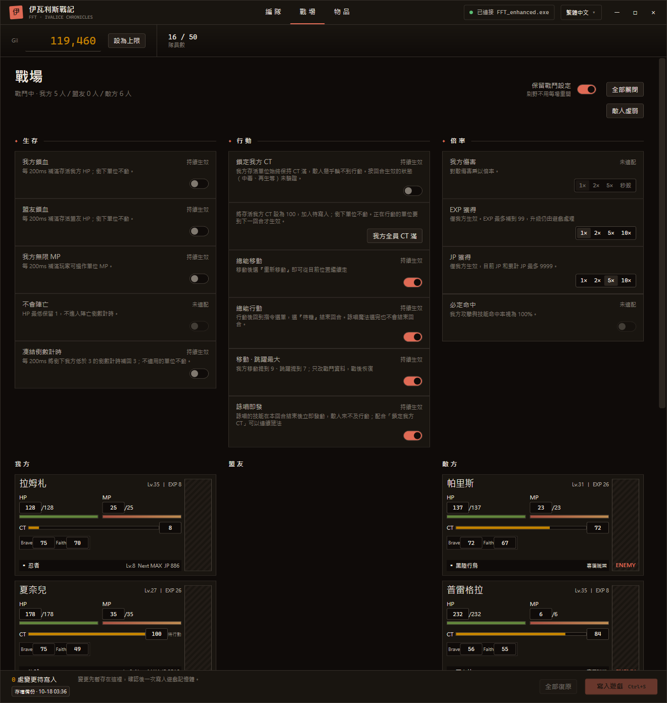
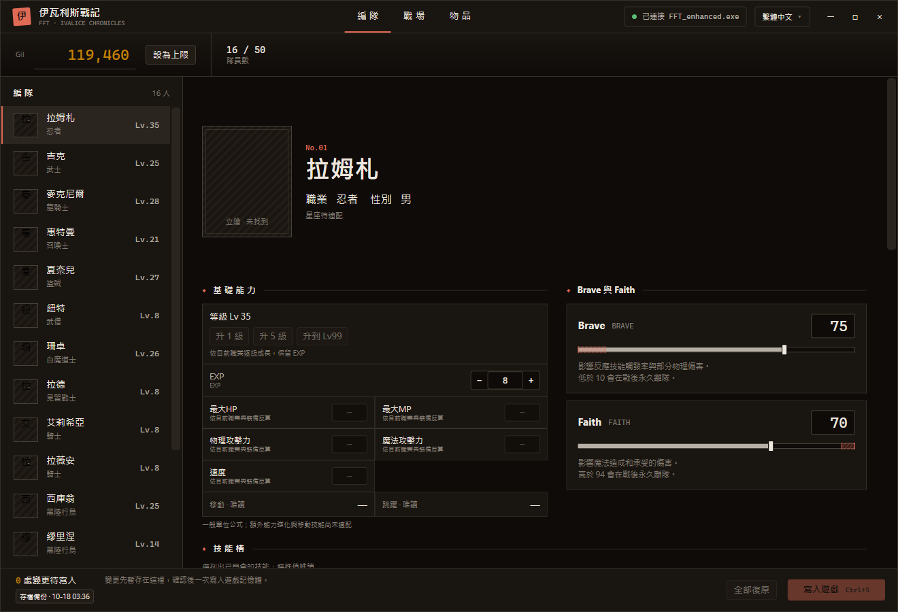
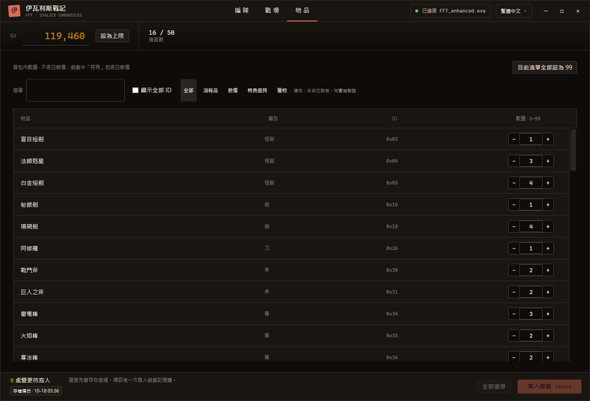

<div align="center">


# Ivalice Trainer

**《最終幻想戰略版 伊瓦利斯編年史》（FFT: The Ivalice Chronicles）PC 修改器，免費開源，無廣告，不需要帳號。**

<p align="center">
  <a href="README.md">English</a> |
  <a href="README.zh_CN.md">简体中文</a> |
  <strong>繁體中文</strong>
</p>

<p align="center">
  <a href="LICENSE">
    
  </a>
  <a href="https://github.com/cqagc/ivalice-trainer/releases/latest">
    
  </a>
  
  
</p>

<p align="center">
  <a href="#description">簡介</a> •
  <a href="#screenshots">截圖</a> •
  <a href="#capabilities">功能</a> •
  <a href="#quick-start">快速上手</a> •
  <a href="#development">開發</a> •
  <a href="#documentation">文件與社群</a> •
  <a href="#upstream">上游專案</a> •
  <a href="#license">許可證</a> •
  <a href="#star-history">Star History</a>
</p>

</div>

<p align="center">
  <a href="docs/screenshots/battle.zh_TW.png">
    
  </a>
</p>

---

<a id="description"></a>

## 📝 簡介

Ivalice Trainer 在遊戲執行時修改 FINAL FANTASY TACTICS - The Ivalice Chronicles（Steam 版）的編隊、道具和戰鬥。它直接讀寫遊戲記憶體，不需要 Cheat Engine。

支援 Windows 10 / 11 x64 上的 **enhanced 版（`FFT_enhanced.exe`）**。介面支援簡體中文、繁體中文、English、Français、Deutsch、日本語、한국어，與遊戲支援的語言一致，各語言都使用遊戲自己的用語。

> [!IMPORTANT]
> 本專案是愛好者製作的非官方工具，與 SQUARE ENIX 無關。修改記憶體有損壞存檔的風險。修改器寫入前會備份存檔目錄，但請自己也做好備份。

> [!NOTE]
> 記憶體地址按 Steam build 24304444 核對。遊戲更新後，在修改器跟進之前可能讀不到資料或拒絕寫入。當前版本 **0.1.0**。

---

<a id="screenshots"></a>

## 截圖

點選圖片檢視原尺寸。

| 編隊 | 物品 |
|---|---|
| [](docs/screenshots/roster.zh_TW.png) | [](docs/screenshots/items.zh_TW.png) |

---

<a id="capabilities"></a>

## 功能

| 功能 | 說明 |
|---|---|
| 編隊 | Gil、等級與 EXP、Brave 與 Faith、各項能力值。升級時按當前職業的成長值增長。 |
| 職業 JP | 按遊戲的規則增加 JP：當前 JP 和累計 JP 同時增加，職業等級按遊戲的門檻更新。 |
| 技能槽 | 副技能、被動、輔助、移動。只列出該單位已經學會的技能。 |
| 物品 | 物品數量，包括特典道具和獵物，可搜尋、按分類篩選。 |
| 戰鬥：生存 | 我方鎖血、盟友鎖血、我方無限 MP、凍結陣亡倒數計時。 |
| 戰鬥：行動 | 鎖定我方 CT、我方全員 CT 滿、總能移動、總能行動、移動 · 跳躍最大、詠唱即發。 |
| 倍率 | EXP 與 JP 獲得 2× / 5× / 10×，只放大遊戲實際給我方的量。 |
| 保留戰鬥設定 | 開關和倍率在戰鬥之間、重啟修改器後都保留。 |
| 暫存寫入 | 編隊和物品的改動先暫存，點 **寫入遊戲**（Ctrl+S）一次寫入；寫入前逐項核對遊戲裡的當前值。 |
| 存檔備份 | 寫入前把存檔目錄複製到 `%LOCALAPPDATA%\FftTrainer\save-backups`（10 分鐘內最多一次，保留最近 20 份）。 |

單位、職業、物品、技能的名稱在執行時從你本機的遊戲檔案裡按所選語言讀取，修改器本身不包含任何遊戲文字或素材。

---

<a id="quick-start"></a>

## 快速上手

1. 安裝 [.NET 10 桌面執行時](https://dotnet.microsoft.com/download/dotnet/10.0)（x64）。
2. 從 [GitHub Releases](https://github.com/cqagc/ivalice-trainer/releases/latest) 下載壓縮包並解壓。
3. 執行 `FftTrainer.App.exe`，再啟動遊戲，修改器會自動連線。

寫入編隊改動前，請先回到世界地圖或隊員列表；在商店或隊員介面裡寫入的改動，離開時可能被遊戲覆蓋。標題欄的語言選單可以切換介面語言。

---

<a id="development"></a>

## 開發

需要 Windows 和 .NET 10 SDK：

```sh
git clone https://github.com/cqagc/ivalice-trainer.git
cd ivalice-trainer
dotnet build src/FftTrainer.App/FftTrainer.App.csproj -c Release
dotnet test tests/FftTrainer.Core.Tests/FftTrainer.Core.Tests.csproj -c Release
```

| 目錄 | 內容 |
|---|---|
| `src/FftTrainer.App/` | WPF 介面 |
| `src/FftTrainer.Core/` | 記憶體讀寫、遊戲規則、檢視模型和介面文字（`Locales/`） |
| `src/FftTrainer.GameFiles/` | 從遊戲封包讀取文字表 |
| `tests/FftTrainer.Core.Tests/` | 單元測試 |
| `tools/FftProbe/` | 命令列記憶體探針：數值掃描、AOB 掃描、讀寫 |
| `docs/` | 記憶體佈局筆記 |

---

<a id="documentation"></a>

## 文件與社群

| 資源 | 說明 |
|---|---|
| [記憶體佈局](docs/memory-map.md) | build 24304444 已確認的地址和結構 |
| `scripts/check_locales.py` | 檢查各語言的 key 和佔位符是否一致 |
| [GitHub Issues](https://github.com/cqagc/ivalice-trainer/issues) | 問題反饋和功能建議 |

反饋問題時請寫明修改器版本、遊戲語言，以及當時在遊戲裡做什麼。

---

<a id="upstream"></a>

## 🔗 上游專案

感謝以下專案的維護者和貢獻者。詳見 [THIRD-PARTY-NOTICES.md](THIRD-PARTY-NOTICES.md)。

| 專案 | 在本專案中的用途 | 許可證 |
|---|---|---|
| [FF16Tools](https://github.com/Nenkai/FF16Tools) | 讀取封包和 Nex 表（原始碼子集） | MIT |
| [fftivc-nex-layouts](https://github.com/Nenkai/fftivc-nex-layouts) | 遊戲文字表的表結構 | MIT |
| [Vortice.Windows](https://github.com/amerkoleci/Vortice.Windows) | DirectStorage 託管繫結，用於解壓 | MIT |
| [Syroot.BinaryData](https://gitlab.com/Syroot/BinaryData) | 二進位制讀取 | MIT |
| [CommunityToolkit.HighPerformance](https://github.com/CommunityToolkit/dotnet) | 記憶體工具 | MIT |

DirectStorage 本身從遊戲安裝目錄載入，不隨修改器分發。

---

<a id="license"></a>

## 📜 許可證

Ivalice Trainer 以 [MIT](LICENSE) 許可證釋出。第三方元件保留各自的許可證。FINAL FANTASY TACTICS 是 SQUARE ENIX 的商標。

---

<a id="star-history"></a>

## 🌟 Star History

<div align="center">

[](https://star-history.com/#cqagc/ivalice-trainer&Date)

</div>

---

<div align="center">

### 感謝

如果覺得好用，歡迎給專案點個 Star。

**[下載最新版](https://github.com/cqagc/ivalice-trainer/releases/latest)** • **[反饋問題](https://github.com/cqagc/ivalice-trainer/issues)**

由 [CQAGC](https://www.cqagc.com) 維護

</div>
